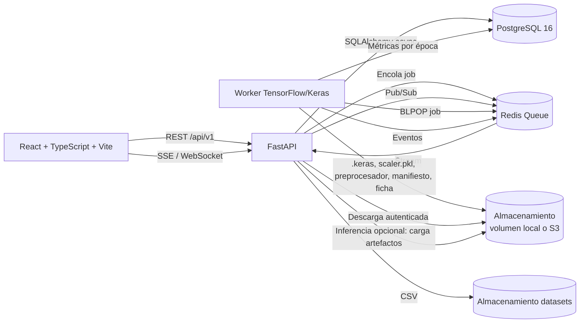

# NeuroLab Enterprise

Plataforma web para **diseñar, validar, entrenar, evaluar y versionar redes neuronales artificiales** con TensorFlow/Keras, trazabilidad de extremo a extremo y ejecución aislada del proceso de entrenamiento.

> Aplicación práctica de la Semana 11: *Define la estructura y crea una red neuronal artificial*.

---

## 1. Estado real del proyecto

Este repositorio es una implementación funcional, no una maqueta. La interfaz React consume la API real, la API persiste en base de datos, y el worker ejecuta entrenamiento Keras real.

| Capacidad | Estado |
|---|---|
| Autenticación JWT, RBAC y ownership por proyecto | ✅ Implementado |
| Proyectos, miembros y auditoría persistida | ✅ Implementado |
| Diseñador visual y validación dimensional en servidor | ✅ Implementado |
| Carga y validación de CSV (esquema, tamaño, target) | ✅ Implementado |
| Entrenamiento real con TensorFlow/Keras en worker aislado | ✅ Implementado para **FEEDFORWARD** tabular |
| Telemetría por época en vivo (SSE/WebSocket) con recuperación | ✅ Implementado |
| Cancelación cooperativa al final de época | ✅ Implementado |
| Rigor ML: semilla, determinismo opcional, baselines, pesos de clase | ✅ Implementado |
| Métricas completas: ROC-AUC, PR-AUC, balanced accuracy, umbral ajustado | ✅ Implementado |
| Artefactos `.keras` + scaler + preprocesador + manifiesto + ficha | ✅ Implementado |
| Manifiesto auditable (`schema_version 2`) y model card en Markdown | ✅ Implementado |
| Registro inmutable de modelos con SHA-256 y ciclo de vida | ✅ Implementado |
| Inferencia en línea (`POST /models/{id}/predict`) | ✅ Implementado como **extra opcional** (requiere `requirements-inference.txt`) |
| Descarga de la ficha (`/card`) y del manifiesto (`/manifest`) | ✅ Implementado (no requiere TensorFlow) |
| Reportes y exportaciones con datos persistidos | ✅ Implementado |
| Administración de usuarios y estado del sistema | ✅ Implementado |
| RNN / CNN / GAN | ✅ RNN y CNN entrenan sobre CSV tabular (adaptador secuencial / convolucional 1D). GAN se diseña y valida; su entrenamiento devuelve `422` con la razón. |
| Object storage S3/MinIO | ✅ Implementado (`STORAGE_BACKEND=s3`). Por defecto se usa un volumen local compartido (`DATA_DIR` / `MODEL_DIR`). |
| Redis | ✅ Backend de cola por defecto. Para desarrollo local también existe `QUEUE_BACKEND=filesystem`. |

No hay rutas `MOCK_*`, datasets de demostración ni métricas inventadas en el frontend.
La inferencia es real: carga los artefactos del modelo entrenado y aplica el
mismo preprocesador, no una respuesta simulada.

---

## 2. Arquitectura



Principios aplicados:

- **TensorFlow no se importa al arrancar FastAPI.** La API sólo valida, persiste y encola; el worker es un proceso independiente. La inferencia es la única excepción: importa TensorFlow de forma perezosa, sólo al atender `POST /predict`, y es una dependencia opcional. Sin ella el endpoint responde `503` y el resto de la plataforma sigue funcionando.
- **PostgreSQL es la fuente de verdad.** Redis transporta trabajos y eventos, pero el estado y las métricas se recuperan de la base de datos tras una reconexión.
- **Máquina de estados estricta:** `QUEUED → PREPARING → RUNNING → COMPLETED | FAILED | CANCELLED`.
- **Artefactos inmutables:** cada modelo exitoso genera una versión nueva con checksum SHA-256; nunca se sobreescribe.
- **Reproducibilidad declarada, no supuesta.** El manifiesto registra semilla, estado real del determinismo, versiones de Python/paquetes y commit de Git; el umbral ajustado se documenta como limitación.
- **Sin datos simulados:** los reportes, KPIs y métricas provienen de la base de datos y de artefactos reales.

---

## 3. Stack

| Capa | Tecnología |
|---|---|
| Frontend | React 19, TypeScript, Vite, Tailwind CSS, lucide-react |
| API | FastAPI, Pydantic v2, SQLAlchemy 2 async, Alembic |
| Base de datos | PostgreSQL 16 (SQLite async para desarrollo y pruebas) |
| Cola / eventos | Redis 7 (`QUEUE_BACKEND=redis`) o filesystem (`QUEUE_BACKEND=filesystem`) |
| ML | TensorFlow 2.x, Keras 3, scikit-learn, pandas, numpy |
| Inferencia (opcional) | TensorFlow + scikit-learn en la API (`requirements-inference.txt`) |
| Seguridad | bcrypt, JWT HS256, RBAC por rol global y por proyecto |
| Almacenamiento | Volumen local o bucket S3 (Supabase Storage) |
| Infraestructura | Docker Compose/Nginx local; Vercel + Railway + Supabase en cloud |

---

## 4. Estructura del repositorio

```
Neurolab_Enterprise/
├── apps/web/                    # Frontend React + TypeScript
│   └── src/
│       ├── app/                 # Shell, routing y providers
│       ├── features/            # M01–M10
│       ├── lib/                 # Cliente API, AuthContext, AppContext
│       └── types/               # Contratos TypeScript
├── services/api/                # FastAPI
│   ├── app/
│   │   ├── api/v1/              # Routers por dominio
│   │   ├── core/                # Config, DB, seguridad, deps, bootstrap
│   │   ├── modules/             # Validación, datasets, cola, eventos, inferencia, auditoría
│   │   ├── repositories/        # Modelos ORM (fuente del esquema)
│   │   └── schemas/             # Contratos Pydantic
│   ├── alembic/                 # Migraciones
│   └── tests/                   # Suite de integración (incluye inferencia)
├── workers/training/            # Worker aislado de TensorFlow/Keras
│   ├── worker.py                # Consumidor y máquina de estados
│   ├── preprocessing.py         # Imputación, encoding, split, pesos de clase y esquema
│   ├── builder.py               # Construcción del modelo Keras con semilla
│   ├── trainer.py               # Callbacks de telemetría, early stopping y cancelación
│   ├── evaluator.py             # Métricas finales sobre test
│   ├── metrics.py               # ROC-AUC, PR-AUC, umbral ajustado y comparación
│   ├── baselines.py             # Baselines Dummy / Logistic / Linear
│   ├── reproducibility.py       # Semillas y determinismo de operadores
│   ├── environment.py           # Versiones de Python/paquetes y commit de Git
│   ├── manifest.py              # Manifiesto auditable y model card
│   ├── storage.py               # Artefactos, manifiesto y SHA-256
│   └── tests/                   # Suite unitaria del núcleo ML (sin TensorFlow)
├── infra/
│   ├── docker/                  # Dockerfiles y Nginx
│   └── migrations/              # DDL PostgreSQL generado (referencia)
├── docs/                        # API, arquitectura, modelo de datos y operación
├── docker-compose.yml
└── .env.example
```

---

## 5. Inicio rápido con Docker

Requisitos: Docker Engine 24+ y Docker Compose v2.

```bash
cp .env.example .env
docker compose up --build
```

Servicios:

| Servicio | URL |
|---|---|
| Frontend | http://localhost:5173 |
| API | http://localhost:8000 |
| Swagger UI | http://localhost:8000/api/v1/docs |
| Healthcheck | http://localhost:8000/health |
| PostgreSQL | `localhost:5432` |
| Redis | `localhost:6379` |

El frontend se sirve con Nginx y consume la API a través del proxy `/api/` del mismo origen (sin CORS y con SSE sin buffering). Los volúmenes `uploads` y `models` están compartidos entre `api` y `worker`; sin ese requisito el worker no puede leer los CSV ni la API descargar los modelos.

### Credenciales iniciales

Se crea un único administrador **sólo si la tabla `users` está vacía**:

- **Email:** `admin@neurolab.enterprise`
- **Contraseña:** la define `SEED_ADMIN_PASSWORD` (mínimo 12 caracteres). Si no se configura, el arranque genera una aleatoria y la muestra una sola vez en los logs.

Cambie la contraseña en el primer acceso. Las variables `SEED_ADMIN_*` no restablecen contraseñas existentes.

### Modo producción

Con `ENVIRONMENT=production` la API **no** ejecuta `create_all`. El contenedor
`infra/docker/entrypoint.api.sh` aplica `alembic upgrade head` y ejecuta
`python -m app.cli seed-admin` antes de arrancar Uvicorn. El seed solo crea el
administrador si la tabla `users` está vacía.

También puede ejecutar los pasos manualmente:

```bash
docker compose run --rm api alembic upgrade head
docker compose run --rm api python -m app.cli seed-admin
docker compose up -d
```

Configure una `SECRET_KEY` robusta: la aplicación rechaza la clave insegura por
defecto en producción.

### Despliegue cloud: Supabase + Vercel + Railway

El frontend puede publicarse en Vercel, la API y el worker en Railway, y la
base de datos/artefactos en Supabase. La guía completa, variables y límites del
plan temporal están en
[`docs/operations/DEPLOY_SUPABASE_VERCEL_RAILWAY.md`](docs/operations/DEPLOY_SUPABASE_VERCEL_RAILWAY.md).

Resumen:

| Componente | Plataforma |
|---|---|
| Base de datos | Supabase Postgres (Session pooler, `sslmode=require`) |
| CSV y modelos `.keras` | Supabase Storage (bucket privado `neurolab`) |
| Frontend | Vercel, root `apps/web`, `VITE_API_URL=https://<api>/api/v1` |
| API + worker | Railway, Dockerfiles `infra/docker/Dockerfile.api` y `Dockerfile.worker` |
| Cola | Railway Redis (`REDIS_URL=${{Redis.REDIS_URL}}`) |

El plan Free Trial de Railway dura 30 días, incluye $5 de crédito y limita cada
servicio a 1 GB de RAM. Render no se usa porque su plan gratuito no permite
background workers y solo ofrece 512 MB.

---

## 6. Desarrollo local sin Docker

> **Arranque preparado para este equipo:** use
> `powershell -ExecutionPolicy Bypass -File scripts/start_local.ps1` (API en
> `8012`, web en `5185`) y consulte `docs/ARRANQUE_LOCAL.md`. No siembra datos de
> demostración. Los pasos manuales de esta sección son la alternativa genérica.

### 6.1 Configuración compartida (`.env`)

La API y el worker leen el **mismo `.env` de la raíz**. Copie la plantilla local:

```powershell
Copy-Item .env.local.example .env
```

Edite `.env` según la base de datos:

- **Supabase:** pegue la cadena Session pooler en `DATABASE_URL` o ejecute
  `python scripts/setup_supabase_db.py --write-env`.
- **SQLite:** descomente la línea de SQLite de la plantilla.

`DATA_DIR=data/uploads` y `MODEL_DIR=data/models` se resuelven dentro de
`services/api`, de modo que API y worker usan los mismos archivos. Las variables
definidas en la terminal tienen prioridad sobre el archivo `.env`.

### 6.2 API

```bash
cd services/api
python -m venv .venv

# Windows
.venv\Scripts\activate
# Linux/macOS
source .venv/bin/activate

pip install -r requirements.txt
python -m uvicorn app.main:app --reload --port 8000
```

Opcionalmente, para habilitar `POST /predict` en la API:

```bash
pip install -r requirements-inference.txt
```

Sin ese archivo la API arranca igual; sólo `/predict` responde `503`. Para
exigir que únicamente se sirvan modelos aprobados, defina
`INFERENCE_REQUIRE_APPROVED=true` en el `.env`.

En desarrollo (`ENVIRONMENT=development`) la API crea el esquema automáticamente y siembra el administrador si no hay usuarios.

### 6.3 Worker de entrenamiento

Debe apuntar a la **misma base de datos** y a los **mismos directorios** que la API. El worker convierte automáticamente `postgresql+asyncpg` → `postgresql+psycopg2` y `sqlite+aiosqlite` → `sqlite`.

```bash
cd workers/training
python -m venv .venv

# Windows
.venv\Scripts\activate
# Linux/macOS
source .venv/bin/activate

pip install -r requirements.txt

python worker.py                 # daemon continuo
python worker.py --once          # procesa un trabajo y sale
python worker.py --job-id <uuid> # re-ejecuta un trabajo concreto desde la BD
```

### 6.4 Frontend

```bash
cd apps/web
npm install
npm run dev
```

El cliente usa `VITE_API_URL` o, por defecto, `http://localhost:8000/api/v1`. Para apuntar a otro backend cree `apps/web/.env.local`:

```env
VITE_API_URL=http://localhost:8000/api/v1
```

---

## 7. Flujo de entrenamiento (MVP)

1. El usuario inicia sesión y crea o abre un proyecto con rol de escritura.
2. Sube un CSV. La API valida encabezados, tamaño, filas, columnas, target y detecta la tarea (`classification` o `regression`).
3. Diseña una red **FEEDFORWARD** y la guarda. La validación dimensional se ejecuta en el servidor y se repite al encolar.
4. Inicia el entrenamiento con hiperparámetros (`epochs`, `batch_size`, `optimizer`, `learning_rate`, `random_seed`, `validation_split`) y las opciones de rigor (`deterministic`, `early_stopping`, `early_stopping_patience`, `reduce_lr_on_plateau`).
5. La API persiste el job en `QUEUED` y escribe el descriptor en Redis (o en la cola de archivos).
6. El worker lo reclama: `QUEUED → PREPARING → RUNNING`.
7. En cada época el worker:
   - persiste las métricas en `training_metrics`;
   - actualiza `progress` y publica un evento en Redis Pub/Sub;
   - comprueba cancelación y timeout de forma cooperativa.
8. Al finalizar:
   - evalúa sobre el conjunto de prueba reservado y calcula baselines sobre las mismas filas;
   - ajusta el umbral de decisión y calcula ROC-AUC, PR-AUC, balanced accuracy y reporte por clase;
   - guarda `model.keras`, `scaler.pkl`, `preprocessor.pkl`, `training_manifest.json` y `model_card.md`;
   - crea una versión de modelo `DRAFT` con checksum SHA-256;
   - marca el job como `COMPLETED`, `FAILED` o `CANCELLED`.
9. La UI actualiza métricas y estado sin recargar. Al reconectar recibe un `snapshot` desde la base de datos y continúa con los eventos en vivo.

### Rigor metodológico del entrenamiento

- **Semilla aplicada en todo el flujo:** Python, NumPy, Keras y el orden de las capas se siembran antes de construir el modelo. `deterministic=true` activa `tf.config.experimental.enable_op_determinism`, que es irreversible por proceso y queda reportado con su estado real.
- **Pesos de clase:** las clases desbalanceadas se compensan con `class_weight` calculado sobre el conjunto de entrenamiento. La distribución y los pesos quedan en el manifiesto y en la ficha.
- **Baselines obligatorios:** se entrenan `DummyClassifier`/`DummyRegressor` y una regresión logística/lineal sobre las mismas características. La comparación usa el F1 ajustado (clasificación) o el RMSE (regresión) y marca `beats_baseline: true/false`. Un empate **no** cuenta como mejora.
- **Métricas completas:** además de accuracy/loss, se registran precisión, recall, F1, ROC-AUC, PR-AUC, balanced accuracy, matriz de confusión, reporte por clase, umbral ajustado y brecha train-test.
- **Manifiesto auditable (`schema_version 2`):** dataset y checksum, particiones, distribución de clases, hiperparámetros, arquitectura, métricas, baselines, entorno (Python y paquetes), commit de Git, estado de determinismo y checksums de artefactos.
- **Model card:** documento Markdown con uso previsto, datos, arquitectura, protocolo de evaluación, métricas, comparación con baselines, limitaciones y trazabilidad.

### Preprocesamiento real

- Lectura robusta de CSV (`utf-8`, `utf-8-sig`, `latin-1`, separador autodetectado).
- Eliminación de filas sin target y validación de al menos 10 filas.
- Detección de tarea y de tipos de columna.
- Imputación: mediana para numéricas, moda para categóricas.
- `StandardScaler` para numéricas; one-hot hasta 30 categorías; ordinal para el resto.
- Split estratificado 70/15/15 cuando la tarea es clasificación.
- Pesos de clase balanceados calculados sólo sobre entrenamiento.
- Ajuste automático de la capa de salida: sigmoide/binaria, softmax/multiclase o lineal/regresión.
- Límite de 5.000 características tras codificar.
- El paquete `scaler.pkl` (versión 2) guarda además `input_schema`, `categorical_values`, columnas, unidades/activación de salida y función de pérdida. Es lo que permite que `/predict` valide la entrada y reutilice exactamente la misma transformación.

### Validación de CSV

| Regla | Límite |
|---|---|
| Extensión | `.csv` |
| Tamaño máximo | 50 MB (`MAX_UPLOAD_MB`) |
| Filas | 10 a 500.000 (`MAX_CSV_ROWS`) |
| Columnas | 2 a 500 (`MAX_CSV_COLUMNS`) |
| Encabezados | explícitos, no vacíos, sin duplicados |
| Target | debe existir y tener al menos 2 valores distintos |

Los errores de validación devuelven `422` con un mensaje legible; un archivo demasiado grande devuelve `413`.

---

## 8. Tiempo real y recuperación

- **SSE:** `GET /api/v1/training-jobs/{job_id}/events?token=<JWT>`
- **WebSocket:** `WS /api/v1/training-jobs/{job_id}/events/ws?token=<JWT>`
- **Eventos:** `snapshot`, `epoch_end`, `metrics`, `state`, `error`.
- **Canal Redis:** `neurolab:job:{job_id}:events`.
- **Cancelación:** clave `neurolab:job:{job_id}:cancel` y publicación de control; en filesystem, `DATA_DIR/cancellations/{job_id}.flag`.

El stream siempre empieza con un `snapshot` leído de PostgreSQL. Después combina Pub/Sub con sondeo periódico a la base de datos. Si el cliente se desconecta o Redis se reinicia, el estado y las épocas faltantes se recuperan sin pérdida.

La cancelación se atiende al inicio o al final de una época; no se destruye el proceso ni se corrompe el artefacto.

---

## 9. Roles y permisos

Roles globales: `ADMIN`, `PROJECT_LEAD`, `AI_ENGINEER`, `REVIEWER`, `VIEWER`.

| Acción | Roles |
|---|---|
| Crear proyecto | `ADMIN`, `PROJECT_LEAD`, `AI_ENGINEER` |
| Editar proyecto / gestionar miembros | `ADMIN`, `PROJECT_LEAD` (rol efectivo en el proyecto) |
| Subir datasets, crear arquitecturas, entrenar, cancelar | `ADMIN`, `PROJECT_LEAD`, `AI_ENGINEER` |
| Aprobar o retirar modelos | `ADMIN`, `PROJECT_LEAD`, `REVIEWER` |
| Administración de usuarios y sistema | `ADMIN` |
| Consulta de proyectos, datasets, jobs, modelos y auditoría | Cualquier miembro del proyecto |

Reglas adicionales:

- El propietario del proyecto tiene rol efectivo `PROJECT_LEAD`.
- Un usuario sin membresía recibe `404` (no se filtra la existencia de proyectos ajenos).
- Un `ADMIN` global tiene acceso a todos los proyectos.
- El frontend oculta acciones no permitidas, pero la autorización real siempre se valida en el backend.

---

## 10. Módulos de la aplicación

| Módulo | Implementación |
|---|---|
| **M01 Dashboard** | KPIs reales de proyectos, jobs recientes, modelos y auditoría; estado del sistema sólo para `ADMIN`. |
| **M02 Proyectos** | CRUD, miembros por email, rol efectivo y conteos reales. |
| **M03 Fundamentos** | Conceptos, activaciones y familias servidos por `/fundamentals`. |
| **M04 Diseñador** | Topologías FNN/RNN/CNN/GAN, validación en servidor y guardado versionado. |
| **M05 Datasets** | Carga CSV, validación, metadatos, preview y eliminación con control de trazabilidad. |
| **M06 Entrenamiento** | Lanzamiento, monitor en vivo, historial de épocas y cancelación. |
| **M07 Evaluación** | Curvas reales por época y comparación de jobs; métricas finales persistidas. |
| **M08 Registro de modelos** | Versiones inmutables, checksum, descarga `.keras`, ficha, manifiesto, prueba de inferencia y transiciones `DRAFT → REVIEWED → APPROVED → RETIRED`. |
| **M09 Reportes** | Fichas y exportaciones CSV/JSON construidas sólo con datos persistidos. |
| **M10 Administración** | Usuarios, roles, estados, estado de BD/Redis/cola y auditoría. |

### Ciclo de vida del modelo

```
DRAFT ──▶ REVIEWED ──▶ APPROVED ──▶ RETIRED
  │           │
  └───────────┴──────────────────────▶ RETIRED
```

`APPROVED` y `RETIRED` requieren `ADMIN`, `PROJECT_LEAD` o `REVIEWER`. Cada transición queda auditada con actor, versión, estado anterior y motivo.

### Inferencia en línea (opcional)

La API puede servir predicciones reales con `POST /api/v1/models/{model_id}/predict`.
Es un **extra opcional**: la imagen base de la API no incluye TensorFlow.

```bash
cd services/api
pip install -r requirements-inference.txt
```

- Carga `model.keras` y `scaler.pkl` del almacenamiento, aplica el mismo preprocesador del entrenamiento y devuelve clase, probabilidad y umbral.
- Valida el esquema (`input_schema`): rechaza campos desconocidos (`422`), campos obligatorios ausentes (`422`) y valores no numéricos (`422`). Una categoría no vista genera una **advertencia**, no un error.
- Para clasificación binaria usa el umbral ajustado en la evaluación salvo que el cliente envíe `threshold` (0–1). El umbral en multiclase o regresión devuelve `422`.
- Un modelo `RETIRED` devuelve `409`. Con `INFERENCE_REQUIRE_APPROVED=true`, cualquier modelo que no esté `APPROVED` devuelve `409`.
- Sin las dependencias opcionales el endpoint responde `503` con un mensaje explícito; `/card`, `/manifest` y la descarga siguen funcionando.
- Cada predicción audita `MODEL_PREDICTED` (modelo, versión, número de registros, tarea y umbral), **sin** guardar los datos de entrada.
- `GET /models/{id}/card` devuelve la ficha en Markdown y `GET /models/{id}/manifest` el manifiesto JSON. Ambos requieren acceso al proyecto.

---

## 11. API

Prefijo: `/api/v1`. Autenticación: `Authorization: Bearer <JWT>`.

| Grupo | Endpoints principales |
|---|---|
| Auth | `POST /auth/login`, `GET /auth/me`, `POST /auth/change-password` |
| Proyectos | `GET/POST /projects`, `GET/PATCH /projects/{id}`, miembros |
| Arquitecturas | `POST /projects/{id}/architectures/validate`, `GET/POST /projects/{id}/architectures` |
| Datasets | `GET /projects/{id}/datasets`, `POST .../upload`, `GET .../{id}`, `GET .../{id}/preview`, `DELETE .../{id}` |
| Entrenamiento | `GET/POST /projects/{id}/training-jobs`, `GET /training-jobs/{id}`, `GET .../metrics`, `POST .../cancel`, SSE/WS |
| Modelos | `GET /projects/{id}/models`, `GET/PATCH /models/{id}`, `PATCH /models/{id}/status`, `GET /models/{id}/download` |
| Inferencia | `POST /models/{id}/predict`, `GET /models/{id}/card`, `GET /models/{id}/manifest` |
| Auditoría | `GET /projects/{id}/audit-events?action=&limit=` |
| Administración | `GET/POST /admin/users`, `PATCH /admin/users/{id}`, `GET /admin/system` |
| Fundamentos | `GET /fundamentals` |
| Salud | `GET /health` |

La especificación detallada, incluidos códigos de error y eventos, está en [`docs/api/API_SPECIFICATION.md`](docs/api/API_SPECIFICATION.md).

---

## 12. Pruebas

API (integración, incluye inferencia con modelo simulado y camino `503`):

```bash
cd services/api
python -m pytest -q
```

Núcleo ML del worker (sin TensorFlow: métricas, baselines, split, manifiesto,
ficha, preprocesamiento y determinismo):

```bash
python -m pytest workers/training/tests -q
```

La suite de API usa SQLite async temporal, cola filesystem y directorios aislados. Cubre autenticación, RBAC, proyectos, validación de datasets, flujo de entrenamiento (incluida cancelación y contrato SSE), ciclo de vida/auditoría de modelos e inferencia (`200`, `404`, `409`, `422`, `503`).

Frontend:

```bash
cd apps/web
npm run build
```

El build ejecuta `tsc` y falla ante errores de tipos.

### Prueba E2E manual

Con la API y el worker apuntando a la misma base de datos y a los mismos directorios:

1. Inicie sesión y cree un proyecto.
2. Suba un CSV válido con target.
3. Cree una arquitectura `FEEDFORWARD` cuyo `input_shape` coincida con las características del dataset.
4. Lance un job con pocas épocas (por ejemplo, 5).
5. Ejecute el worker (`python worker.py --once` o daemon) y observe el estado en la UI.
6. Al completar, descargue el `.keras` desde el registro de modelos.
7. Abra **Ficha**, revise las métricas y la comparación con baselines y el manifiesto.
8. En **Probar modelo**, envíe un registro y confirme que la probabilidad y la clase provienen del modelo real.

Verificación automatizada usada durante el desarrollo (fuera del repositorio):
entrena un dataset sintético con desbalance y una columna categórica, comprueba
los cinco artefactos, el manifiesto `schema_version 2`, la comparación con
baselines y una inferencia real con una categoría no vista. Se ejecutó con
`STORAGE_BACKEND=local`, `QUEUE_BACKEND=filesystem` y SQLite.

Corrida real contra Supabase (PostgreSQL 17.11) con el CSV
`data_prueba_clientes.csv` (600 filas, target `abandono`, 9 neuronas de entrada):

- Proyecto `Clientes Abandono (Feedforward)`; arquitectura `MLP 9-16-8-1`
  (305 parámetros, salida `1/sigmoid`, `binary_crossentropy`).
- Job `8e7e21ae-41a1-42b5-af82-e2f3cbb45613`: `COMPLETED`, 25/25 épocas,
  100 filas en `training_metrics`.
- Modelo `v1.1` (`8b223445-57bb-4018-b532-7ebaaa603016`): accuracy de prueba
  0.8778, F1 0.8070, ROC-AUC 0.8886, umbral 0.5598.
- Artefactos `model.keras`, `scaler.pkl`, `preprocessor.pkl`,
  `training_manifest.json` y `model_card.md` con SHA-256 verificado contra el
  disco; `/predict` respondió `200` con probabilidades reales.

> Si la API responde `503` al encolar, revise `QUEUE_BACKEND` en el `.env`
> compartido: la API y el worker deben usar el mismo backend (`filesystem` o
> `redis`). La API lo lee desde `Settings`, igual que el worker.

---

## 13. Migraciones

Alembic es la fuente de verdad del esquema. Los modelos ORM están en `services/api/app/repositories/models.py`.

```bash
cd services/api

# Aplicar
alembic upgrade head

# Ver la revisión actual
alembic current

# Verificar que no hay cambios sin migrar
alembic check

# Crear una nueva migración tras cambiar los modelos
alembic revision --autogenerate -m "descripcion"
```

`infra/migrations/001_initial_schema.sql` es una referencia PostgreSQL generada desde Alembic. **No** se monta como script de inicialización.

---

## 14. Limitaciones conocidas (MVP)

- Entrenamiento real habilitado para **FEEDFORWARD, RNN y CNN** sobre CSV tabular. Las CNN usan el adaptador convolucional 1D (`Conv1D`/`MaxPooling1D`); `Conv2D`/`MaxPooling2D` se rechazan porque los datos tabulares no son imágenes. GAN se valida y persiste, pero el worker rechaza su entrenamiento con un mensaje explícito.
- La descarga directa expone únicamente `model.keras`; scaler, preprocesador, manifiesto y ficha viven junto al artefacto y se consultan por `/card` y `/manifest` o desde el volumen.
- **Inferencia opcional y síncrona:** requiere instalar `requirements-inference.txt` en el servicio de API; mantiene hasta 4 modelos en memoria (LRU) y serializa las llamadas a Keras. No hay cola de inferencia por lotes ni autoescalado por carga.
- El umbral de decisión se ajusta sobre el conjunto de prueba. Es una decisión documentada en la ficha y en el manifiesto, pero para producción estricta convendría un conjunto de calibración independiente.
- `deterministic=true` activa `enable_op_determinism`, que es global al proceso y puede reducir el rendimiento. Su estado real se reporta en el manifiesto; no se puede desactivar sin reiniciar el worker.
- No se implementa validación cruzada k-fold ni un informe de calidad del dataset (Nivel C, fuera del alcance actual).
- `scaler.pkl` y `preprocessor.pkl` se deserializan con `pickle`. Sólo se aceptan claves bajo `models/`, que únicamente escribe el worker; nunca se deserializa contenido enviado por un cliente.
- El rate limit de login es en memoria por proceso. En un despliegue con varias réplicas debe moverse a Redis.
- El almacenamiento local (`STORAGE_BACKEND=local`) exige que API y worker compartan volumen. Para hosts separados use `STORAGE_BACKEND=s3` (Supabase Storage, MinIO, S3 o R2); el despliegue cloud documentado usa Supabase Storage.
- Las notificaciones en tiempo real requieren Redis; en modo filesystem el frontend usa el sondeo de respaldo de la API.
- SQLite async se usa para desarrollo y pruebas; el despliegue real debe usar PostgreSQL.

---

## 15. Documentación

- [Especificación de API y eventos](docs/api/API_SPECIFICATION.md)
- [Arquitectura y decisiones](docs/architecture/ARCHITECTURE.md)
- [Modelo de datos](docs/architecture/DATA_MODEL.md)
- [Guía de despliegue y operación](docs/operations/DEPLOYMENT_GUIDE.md)
- [Despliegue Supabase + Vercel + Railway](docs/operations/DEPLOY_SUPABASE_VERCEL_RAILWAY.md)
