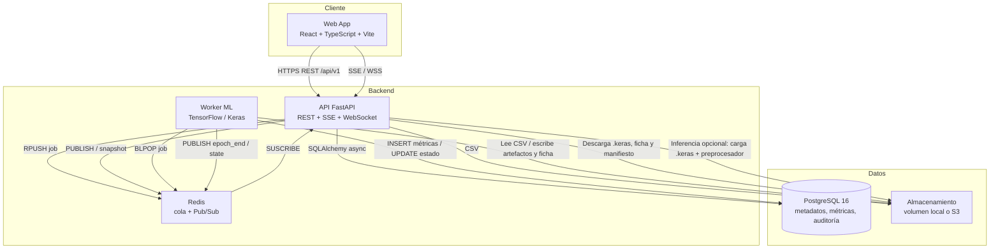
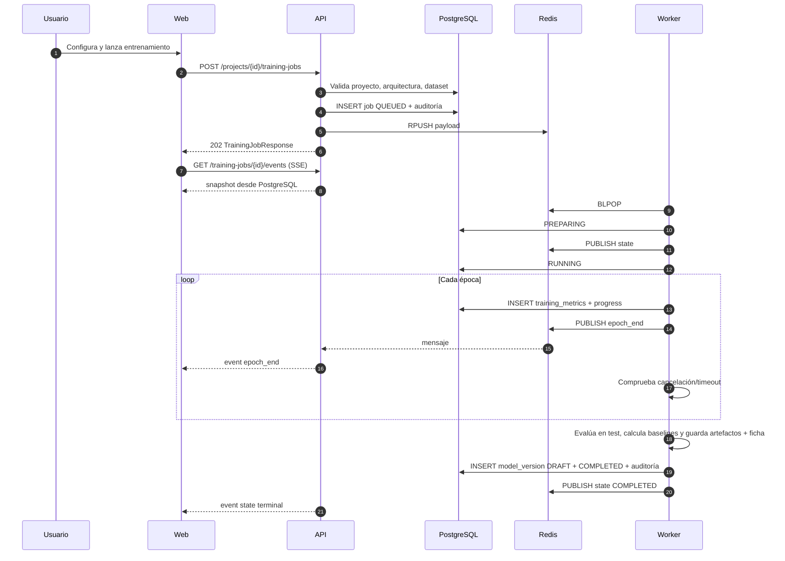
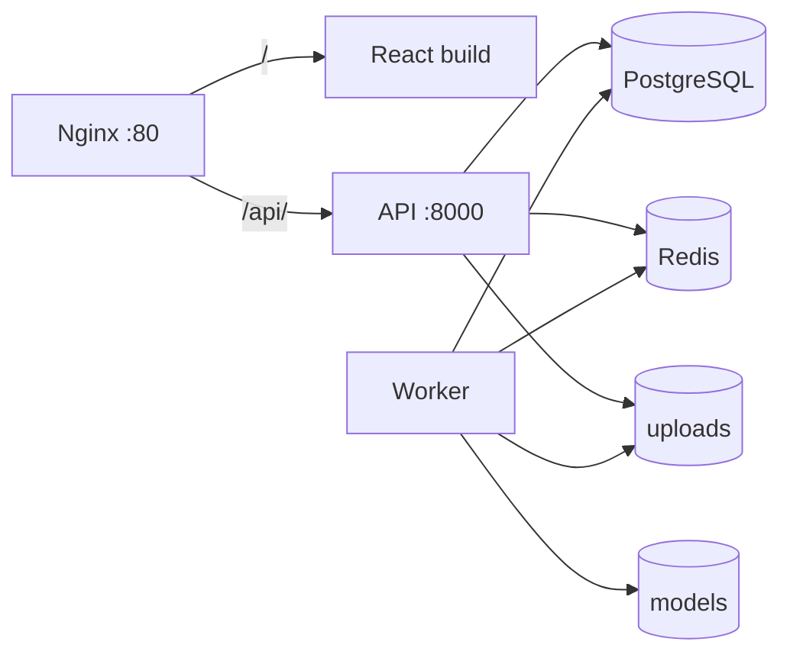
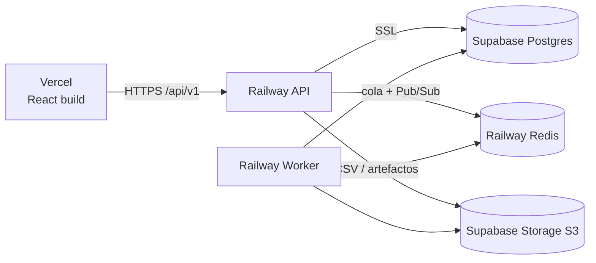

# Arquitectura de NeuroLab Enterprise

## 1. Visión y metas técnicas

NeuroLab Enterprise conecta la experimentación académica con redes neuronales (Semana 11) con un estándar de operación empresarial:

- **Aislamiento de cómputo:** TensorFlow/Keras se ejecuta exclusivamente en un proceso worker, nunca dentro del proceso FastAPI.
- **Trazabilidad:** cada job conserva hiperparámetros, checksum del dataset, versión de código, métricas por época y auditoría.
- **Reproducibilidad:** semilla aleatoria, split congelado, artefactos de preprocesamiento y checksum SHA-256 del modelo.
- **Recuperación:** PostgreSQL es la fuente de verdad; un reinicio de Redis o una desconexión del cliente no pierde estado ni métricas.
- **Seguridad:** JWT, RBAC global y por proyecto, ownership, rate limit de login y validación de rutas de almacenamiento.

---

## 2. Diagrama de contenedores (C4, nivel 2)



### Componentes

| Componente | Responsabilidad | No hace |
|---|---|---|
| **Web** | UI, navegación, formularios, gráficas, descarga autenticada, ficha, prueba de inferencia, reconexión de eventos | No entrena ni calcula métricas del modelo |
| **API** | Autenticación, RBAC, validación, persistencia, encolado, streaming, auditoría, inferencia opcional | No entrena ni ejecuta `fit()`; sólo importa TensorFlow de forma perezosa si se habilita `/predict` |
| **Worker** | Preprocesamiento, construcción Keras, entrenamiento, evaluación, baselines, artefactos, telemetría | No atiende HTTP ni aplica reglas de autorización |
| **PostgreSQL** | Estado de jobs, métricas, versiones, usuarios, auditoría | No almacena binarios de modelos |
| **Redis** | Cola de trabajos, Pub/Sub de eventos, flags de cancelación | No es fuente de verdad |
| **Volumen / bucket** | CSV originales, artefactos del modelo y ficha | No se sirve públicamente |

---

## 3. Flujo de un entrenamiento



### Máquina de estados

```
QUEUED ──▶ PREPARING ──▶ RUNNING ──▶ COMPLETED
   │            │            │
   │            │            ├──────▶ FAILED
   │            │            └──────▶ CANCELLED
   └────────────┴───────────────────▶ FAILED / CANCELLED
```

- `QUEUED`: job persistido y descriptor encolado.
- `PREPARING`: el worker reclama el job, limpia métricas previas y prepara el CSV.
- `RUNNING`: modelo compilado; se emiten métricas por época.
- `COMPLETED`: evaluación final, artefactos guardados y versión de modelo creada.
- `FAILED`: error de datos, construcción, entrenamiento o timeout. `error_message` contiene la causa.
- `CANCELLED`: solicitado por el usuario y atendido cooperativamente.

La transición y el timestamp se escriben en PostgreSQL; el evento correspondiente se publica en Redis para reducir latencia. Si Redis falla, el cliente sigue recibiendo el estado por sondeo.

---

## 4. Cola y recuperación

### Backends

| Backend | Uso | Implementación |
|---|---|---|
| `QUEUE_BACKEND=redis` | Producción y Docker Compose | `RPUSH`/`BLPOP` sobre `TRAINING_QUEUE`; Pub/Sub por job |
| `QUEUE_BACKEND=filesystem` | Desarrollo local y pruebas | Descriptor JSON en `DATA_DIR/queue`; reclamación atómica con `os.replace` a `queue/processing` |

En ambos casos el worker es un **proceso separado**. El backend de archivos no ejecuta ML en la API; sólo sustituye el transporte.

### Recuperación

- **Worker reiniciado (filesystem):** al arrancar, los descriptores en `queue/processing` se devuelven a `queue`. Un job interrumpido se re-ejecuta; las métricas previas se limpian al entrar en `PREPARING`.
- **Redis reiniciado:** la API no depende de Pub/Sub para el estado. El stream consulta PostgreSQL cada 1,5 s y emite las épocas y transiciones faltantes.
- **Cliente desconectado:** al reconectar recibe primero un `snapshot` con el historial completo y luego sólo lo nuevo.
- **Cancelación no entregada:** se persiste `cancel_requested=true`; el worker la consulta en la base de datos además del flag/Redis.
- **Timeout:** el callback de Keras detiene el entrenamiento al superar `TRAINING_TIMEOUT_SECONDS` (2 h por defecto) y el job pasa a `FAILED`.

### Idempotencia

- Un job en estado terminal (`COMPLETED`/`CANCELLED`) se omite si el worker lo recibe de nuevo.
- El worker limpia métricas antes de reentrenar.
- Las versiones de modelo se crean sólo al completar; no se reutiliza ni sobreescribe un artefacto existente.

---

## 5. Telemetría en tiempo real

### Canales

- **Pub/Sub:** `neurolab:job:{job_id}:events`.
- **Control:** `neurolab:job:{job_id}:control` (`{"action":"CANCEL"}`).
- **Cancelación:** `neurolab:job:{job_id}:cancel` (TTL 1 h).
- **Filesystem:** `DATA_DIR/cancellations/{job_id}.flag` y `DATA_DIR/queue`.

### Estrategia híbrida

1. El worker escribe cada época en `training_metrics` y actualiza `training_jobs.progress`.
2. Publica `epoch_end` en Redis para entrega inmediata.
3. La API mantiene el stream SSE/WS: snapshot inicial + Pub/Sub + sondeo a PostgreSQL.
4. Al detectar un estado terminal, hace una última lectura y cierra.

Esto evita duplicados: el stream lleva la última época emitida y sólo envía métricas con `epoch > last_epoch`.

---

## 6. Almacenamiento de artefactos

```
MODEL_DIR/
└── models/{project_id}/{job_id}/
    ├── model.keras
    ├── scaler.pkl
    ├── preprocessor.pkl
    ├── training_manifest.json
    └── model_card.md

DATA_DIR/
├── datasets/{project_id}/{dataset_id}.csv
├── queue/
│   └── processing/
├── cancellations/
└── events/
```

- `storage_key` persistido es relativo a la raíz de almacenamiento (`models/...` o `datasets/...`) y se valida contra path traversal antes de leer o descargar.
- `training_manifest.json` (`schema_version 2`) incluye versión de esquema, versión de código y de modelo, tarea, target, dimensiones, pérdida, etiquetas de clase, columnas, conteos de split, distribución de clases y pesos, hiperparámetros, checksum del dataset, entorno (Python, paquetes, commit de Git), estado de determinismo, generalización, baselines, comparación con baselines, métricas y checksums de cada artefacto.
- `model_card.md` se genera con el mismo manifiesto: uso previsto, datos, arquitectura, protocolo de evaluación, métricas, comparación con baselines, limitaciones y trazabilidad.
- El checksum del modelo (`model_versions.checksum`) es SHA-256 del archivo `.keras`.
- `STORAGE_BACKEND=local` usa `DATA_DIR`/`MODEL_DIR` compartidos. `STORAGE_BACKEND=s3` usa un bucket compatible con S3 (Supabase Storage, MinIO, AWS S3 o R2) y es el modo requerido cuando API y worker corren en hosts distintos. Ambas implementaciones comparten las mismas claves lógicas, por lo que la base de datos no cambia al migrar de local a S3.
- La API puede leer `model.keras`, `scaler.pkl`, `training_manifest.json` y `model_card.md` para inferencia y trazabilidad. La descarga pública del registro sigue limitada a `model.keras`.

---

## 7. Seguridad

### Autenticación

- Contraseñas con bcrypt.
- JWT HS256 firmado con `SECRET_KEY`; contiene `sub` (UUID), `email` y `role`.
- El usuario se recarga desde la base de datos en cada request; un usuario inactivo pierde acceso aunque su token siga vigente.
- `SECRET_KEY` insegura por defecto se rechaza con `ENVIRONMENT=production`.

### Autorización

- **Rol global:** `ADMIN`, `PROJECT_LEAD`, `AI_ENGINEER`, `REVIEWER`, `VIEWER`.
- **Rol efectivo por proyecto:** `ADMIN` global → `ADMIN`; propietario → `PROJECT_LEAD`; miembro → su rol; sin membresía → `404`.
- Escritura: `ADMIN`, `PROJECT_LEAD`, `AI_ENGINEER`.
- Aprobación/retiro de modelos: `ADMIN`, `PROJECT_LEAD`.
- Administración: `ADMIN`.

### Superficie

- Validación de entrada con Pydantic (rangos, enums, longitudes).
- Validación dimensional de arquitecturas en el servidor, repetida al encolar.
- CSV: extensión, tamaño, encabezados, filas, columnas y target.
- Rutas de dataset y modelo resueltas y confinadas a sus directorios base.
- CORS restringido a orígenes configurados.
- Cabeceras `X-Content-Type-Options`, `X-Frame-Options`, `Referrer-Policy`.
- Rate limit de login por IP (en memoria, por proceso).
- Inferencia: esquema de entrada validado contra el entrenamiento; se rechazan campos desconocidos y valores no finitos; el umbral se limita a `[0, 1]`; un modelo `RETIRED` no se sirve y `INFERENCE_REQUIRE_APPROVED` puede exigir `APPROVED`.
- `scaler.pkl` y `preprocessor.pkl` se deserializan con `pickle`, pero sólo desde claves bajo `models/` que escribe el worker; nunca desde contenido enviado por un cliente.
- Auditoría de acciones sensibles; la inferencia audita metadatos pero no los datos de entrada.

### Limitaciones de seguridad del MVP

- El rate limit no es distribuido.
- Los tokens se guardan en `localStorage` en el frontend; no hay rotación ni refresh tokens.
- La descarga usa JWT en cabecera; los enlaces directos del navegador requieren el flujo autenticado del cliente.

---

## 8. Decisiones arquitectónicas (ADR)

### ADR-01 — Desacoplar TensorFlow de la API

- **Contexto:** `fit()` bloquea el event loop y consume CPU/GPU.
- **Decisión:** worker independiente; la API sólo valida y encola. La inferencia es una excepción acotada: un módulo opcional importa TensorFlow de forma perezosa, sólo al atender `POST /predict`, y el despliegue base no instala esas dependencias.
- **Consecuencia:** escalado separado, aislamiento de fallos e imagen base de API ligera. Habilitar inferencia añade cientos de MB al servicio de API y debe decidirse por despliegue (`--build-arg INSTALL_INFERENCE=true` o `pip install -r requirements-inference.txt`).

### ADR-02 — PostgreSQL como fuente de verdad y Redis como transporte

- **Contexto:** Pub/Sub no persiste mensajes.
- **Decisión:** métricas y estado siempre en PostgreSQL; Redis acelera la entrega.
- **Consecuencia:** recuperación tras reconexión y consistencia; mayor carga de escritura por época.

### ADR-03 — Artefactos inmutables con checksum

- **Contexto:** sobreescribir un modelo rompe la reproducibilidad y la auditoría.
- **Decisión:** directorio por job, archivo nuevo por versión y SHA-256 registrado.
- **Consecuencia:** trazabilidad completa; requiere política de retención de almacenamiento.

### ADR-04 — Backend de cola conmutable

- **Contexto:** el entorno local no siempre tiene Redis.
- **Decisión:** `QUEUE_BACKEND=redis|filesystem`, mismo contrato de payload y mismo worker.
- **Consecuencia:** desarrollo sin infraestructura; Redis sigue siendo el valor por defecto.

### ADR-05 — Entrenamiento tabular para FEEDFORWARD, RNN y CNN

- **Contexto:** los datos del MVP son CSV tabulares. Las RNN y CNN pueden aplicarse adaptando el vector de características a una secuencia `(features, 1)`; GAN requiere un esquema generador/discriminador que el MVP no implementa.
- **Decisión:** FEEDFORWARD, RNN y CNN se entrenan de forma real. GAN se valida, guarda y documenta, pero su entrenamiento devuelve `422` con una razón explícita.
- **Consecuencia:** alcance honesto y extensible; no se simulan resultados ni se entrena una topología distinta a la diseñada.

### ADR-06 — Almacenamiento abstraído: volumen local o bucket S3

- **Contexto:** en Docker Compose, API y worker pueden compartir volúmenes; en Railway/Vercel/Supabase corren en hosts distintos y un disco local no es compartido ni persistente.
- **Decisión:** una interfaz de almacenamiento con dos implementaciones (`local` y `s3`) sobre las mismas claves `datasets/...` y `models/...`. La API escribe/lee el bucket y el worker descarga el CSV y publica los artefactos.
- **Consecuencia:** el despliegue local sigue siendo simple; el cloud usa Supabase Storage sin cambiar el esquema de base de datos ni los contratos de la API.

### ADR-07 — Inferencia como módulo opcional en la API

- **Contexto:** el jurado y un usuario real esperan poder usar el modelo, no sólo descargarlo. A la vez, TensorFlow en la API contradice el aislamiento de cómputo y dispara el consumo del plan gratuito.
- **Decisión:** `POST /models/{id}/predict` vive en la API, pero sus dependencias (`tensorflow`, `scikit-learn`) están separadas en `requirements-inference.txt`. El módulo las importa sólo al usarlas y responde `503` si faltan. `GET /card` y `GET /manifest` no las necesitan.
- **Consecuencia:** se demuestra inferencia real con el mismo preprocesador del entrenamiento sin cargar TensorFlow en el arranque ni en los despliegues que no lo necesitan. La caché LRU acota la memoria y serializa las llamadas a Keras; no sustituye a un servidor de modelos dedicado.

---

## 9. Despliegue

### 9.1 Docker Compose local



- `web` sirve el build estático y hace proxy de `/api/` y SSE.
- `api` y `worker` comparten los volúmenes `uploads` y `models`.
- `worker` espera a que `api` esté healthy para arrancar.
- El entrypoint aplica `alembic upgrade head` y el seed del administrador.

### 9.2 Cloud gestionado



- Vercel solo sirve el frontend; las llamadas REST/SSE van directas a Railway.
- El bucket es privado y se accede con claves S3 del proyecto Supabase.
- Railway Free Trial: 30 días, $5 de crédito y 1 GB por servicio.
- La guía operativa está en
  [`docs/operations/DEPLOY_SUPABASE_VERCEL_RAILWAY.md`](../operations/DEPLOY_SUPABASE_VERCEL_RAILWAY.md).

---

## 10. Observabilidad y operación

- `GET /health`: estado de la base de datos, versión y entorno.
- `GET /api/v1/admin/system`: base de datos, Redis, backend de cola, límites y uptime.
- Logs estructurados por proceso (`neurolab.api`, `neurolab.worker`, `neurolab.trainer`, `neurolab.inference`).
- Auditoría consultable por proyecto y acción.
- Estados terminales con `error_message` legible y evento `state`.

Métricas Prometheus no están expuestas en el MVP; `prometheus-client` figura como dependencia preparada, pero no hay endpoint `/metrics` cableado.
