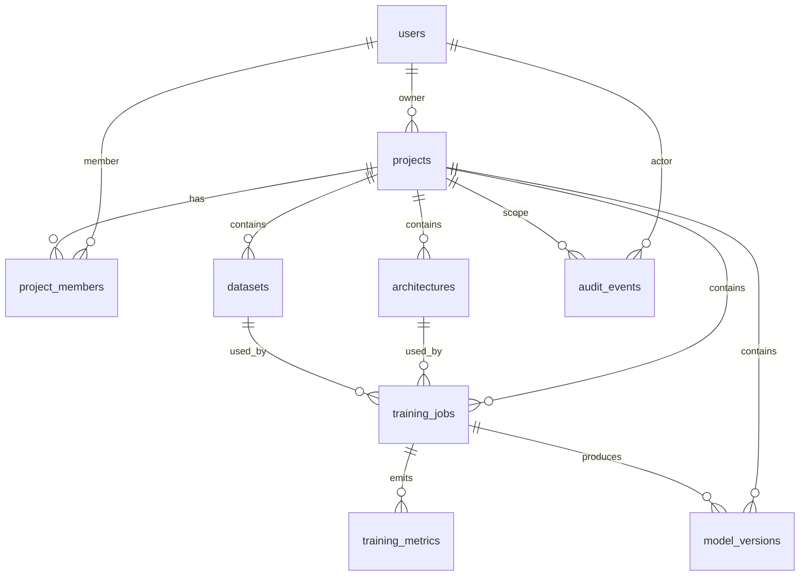

# Modelo de datos

Fuente de verdad del esquema: `services/api/app/repositories/models.py` (SQLAlchemy 2) y las migraciones de `services/api/alembic/`.

- **PostgreSQL 16** en Docker/producción.
- **SQLite async** para desarrollo local y pruebas.
- Tipos portables: `Uuid` para identificadores y `JSON` con variante `JSONB` en PostgreSQL.
- Fechas `TIMESTAMPTZ` en PostgreSQL, con `UTC` como convención de aplicación.
- `infra/migrations/001_initial_schema.sql` es DDL PostgreSQL generado como referencia; no se ejecuta automáticamente.

---

## 1. Diagrama de relaciones



---

## 2. Diccionario de datos

### 2.1 `users`

| Columna | Tipo | Restricciones |
|---|---|---|
| `id` | UUID | PK, default `uuid4` |
| `email` | VARCHAR(255) | NOT NULL, UNIQUE, indexado |
| `password_hash` | VARCHAR(255) | NOT NULL (bcrypt) |
| `display_name` | VARCHAR(150) | NOT NULL |
| `role` | VARCHAR(50) | NOT NULL, default `AI_ENGINEER` |
| `status` | VARCHAR(50) | NOT NULL, default `ACTIVE` |
| `created_at` | TIMESTAMPTZ | NOT NULL |
| `updated_at` | TIMESTAMPTZ | NOT NULL, `onupdate` |

Valores válidos de `role`: `ADMIN`, `PROJECT_LEAD`, `AI_ENGINEER`, `REVIEWER`, `VIEWER`.
Valores válidos de `status`: `ACTIVE`, `INACTIVE`, `SUSPENDED`.

### 2.2 `projects`

| Columna | Tipo | Restricciones |
|---|---|---|
| `id` | UUID | PK |
| `name` | VARCHAR(200) | NOT NULL |
| `description` | TEXT | NULL |
| `owner_id` | UUID | FK → `users.id` `ON DELETE CASCADE`, NOT NULL |
| `status` | VARCHAR(50) | NOT NULL, default `ACTIVE` |
| `network_family` | VARCHAR(50) | NOT NULL, default `FEEDFORWARD` |
| `created_at` | TIMESTAMPTZ | NOT NULL |
| `updated_at` | TIMESTAMPTZ | NOT NULL, `onupdate` |

Índice: `idx_projects_owner (owner_id)`.
`status`: `ACTIVE` o `ARCHIVED`.
`network_family`: `FEEDFORWARD`, `RNN`, `CNN` o `GAN`. Es la familia por defecto del diseñador; el proyecto puede contener arquitecturas de otras familias. `FEEDFORWARD`, `RNN` y `CNN` están habilitadas para entrenamiento con CSV tabular; `GAN` es conceptual.

### 2.3 `project_members`

| Columna | Tipo | Restricciones |
|---|---|---|
| `project_id` | UUID | PK compuesta, FK → `projects.id` `ON DELETE CASCADE` |
| `user_id` | UUID | PK compuesta, FK → `users.id` `ON DELETE CASCADE` |
| `role` | VARCHAR(50) | NOT NULL, default `AI_ENGINEER` |
| `added_at` | TIMESTAMPTZ | NOT NULL |

PK compuesta `(project_id, user_id)`. El propietario no necesita fila aquí: su rol efectivo se deriva de `projects.owner_id`.

### 2.4 `architectures`

| Columna | Tipo | Restricciones |
|---|---|---|
| `id` | UUID | PK |
| `project_id` | UUID | FK → `projects.id` `ON DELETE CASCADE`, NOT NULL |
| `name` | VARCHAR(200) | NOT NULL |
| `family` | VARCHAR(50) | NOT NULL |
| `config_json` | JSONB / JSON | NOT NULL |
| `version` | INTEGER | NOT NULL, default `1` |
| `created_by` | UUID | FK → `users.id` `ON DELETE SET NULL`, NULL |
| `created_at` | TIMESTAMPTZ | NOT NULL |

Índice: `idx_architectures_project (project_id)`.

`family`: `FEEDFORWARD`, `RNN`, `CNN`, `GAN`.
`config_json` guarda `input_shape` y `layers` (tipo, unidades, activación, rate, filtros, kernel, pool, `return_sequences`). La versión se incrementa por nombre dentro del proyecto.

### 2.5 `datasets`

| Columna | Tipo | Restricciones |
|---|---|---|
| `id` | UUID | PK |
| `project_id` | UUID | FK → `projects.id` `ON DELETE CASCADE`, NOT NULL |
| `name` | VARCHAR(200) | NOT NULL |
| `version` | VARCHAR(50) | NOT NULL, default `v1.0` |
| `storage_key` | VARCHAR(500) | NOT NULL |
| `original_filename` | VARCHAR(255) | NOT NULL |
| `size_bytes` | INTEGER | NOT NULL, default `0` |
| `checksum` | VARCHAR(128) | NOT NULL, SHA-256 del CSV |
| `target_column` | VARCHAR(150) | NULL |
| `verified` | BOOLEAN | NOT NULL, default `false` |
| `metadata_json` | JSONB / JSON | NOT NULL |
| `created_by` | UUID | FK → `users.id` `ON DELETE SET NULL`, NULL |
| `created_at` | TIMESTAMPTZ | NOT NULL |

Índice: `idx_datasets_project (project_id)`.
`storage_key` es una clave lógica relativa a la raíz de datasets, por ejemplo `datasets/{project_id}/{dataset_id}.csv`. Se resuelve contra `DATA_DIR` en modo local o contra el bucket `S3_BUCKET` en modo S3.

Contenido de `metadata_json`:

```json
{
  "samples": 40,
  "features_count": 3,
  "target_column": "abandono",
  "task": "classification",
  "columns": [
    { "name": "edad", "dtype": "int64", "null_count": 0, "unique": 40 }
  ],
  "null_counts": { "edad": 0 },
  "dtypes": { "edad": "int64" },
  "train_split": 0.7,
  "val_split": 0.15,
  "test_split": 0.15,
  "verified": true
}
```

### 2.6 `training_jobs`

| Columna | Tipo | Restricciones |
|---|---|---|
| `id` | UUID | PK |
| `project_id` | UUID | FK → `projects.id` `ON DELETE CASCADE`, NOT NULL |
| `architecture_id` | UUID | FK → `architectures.id` `ON DELETE RESTRICT`, NOT NULL |
| `dataset_id` | UUID | FK → `datasets.id` `ON DELETE RESTRICT`, NOT NULL |
| `status` | VARCHAR(50) | NOT NULL, default `QUEUED` |
| `progress` | DOUBLE PRECISION | NOT NULL, default `0.0` |
| `hyperparameters` | JSONB / JSON | NOT NULL |
| `cancel_requested` | BOOLEAN | NOT NULL, default `false` |
| `requested_by` | UUID | FK → `users.id` `ON DELETE SET NULL`, NULL |
| `started_at` | TIMESTAMPTZ | NULL |
| `ended_at` | TIMESTAMPTZ | NULL |
| `error_message` | TEXT | NULL |
| `created_at` | TIMESTAMPTZ | NOT NULL |

Índices: `idx_training_jobs_project (project_id)`, `idx_training_jobs_status (status)`.

`RESTRICT` en arquitectura y dataset impide borrar entidades con trazabilidad de entrenamiento.

`hyperparameters` contiene lo enviado por el usuario más metadatos de reproducibilidad:

```json
{
  "epochs": 50,
  "batch_size": 32,
  "optimizer": "adam",
  "learning_rate": 0.001,
  "loss": null,
  "metrics": ["accuracy"],
  "random_seed": 42,
  "validation_split": 0.15,
  "target_column": "abandono",
  "task": "classification",
  "dataset_checksum": "e3b0...",
  "dataset_version": "v1.0",
  "code_version": "1.0.0"
}
```

`progress` va de `0.0` a `100.0`; durante la ejecución se limita a `99.0`.

### 2.7 `training_metrics`

| Columna | Tipo | Restricciones |
|---|---|---|
| `id` | INTEGER | PK, autoincremental |
| `job_id` | UUID | FK → `training_jobs.id` `ON DELETE CASCADE`, NOT NULL |
| `epoch` | INTEGER | NOT NULL |
| `metric_name` | VARCHAR(100) | NOT NULL |
| `metric_value` | DOUBLE PRECISION | NOT NULL |
| `recorded_at` | TIMESTAMPTZ | NOT NULL |

Índice: `idx_metrics_job_epoch (job_id, epoch)`.
Restricción única: `uq_metric_job_epoch_name (job_id, epoch, metric_name)`.

Formato largo: una fila por métrica y época (`loss`, `accuracy`, `val_loss`, `val_accuracy`). La API las agrega por época para la respuesta y para el stream.

### 2.8 `model_versions`

| Columna | Tipo | Restricciones |
|---|---|---|
| `id` | UUID | PK |
| `project_id` | UUID | FK → `projects.id` `ON DELETE CASCADE`, NOT NULL |
| `job_id` | UUID | FK → `training_jobs.id` `ON DELETE RESTRICT`, NOT NULL |
| `version` | VARCHAR(50) | NOT NULL |
| `storage_key` | VARCHAR(500) | NOT NULL, clave lógica `models/{project_id}/{job_id}/model.keras` (local o S3) |
| `status` | VARCHAR(50) | NOT NULL, default `DRAFT` |
| `checksum` | VARCHAR(128) | NOT NULL, SHA-256 del `.keras` |
| `metrics_summary` | JSONB / JSON | NULL |
| `created_at` | TIMESTAMPTZ | NOT NULL |

Índice: `idx_model_versions_project (project_id)`.
`status`: `DRAFT`, `REVIEWED`, `APPROVED`, `RETIRED`.
La versión se calcula por proyecto (`v1.0`, `v1.1`, …). El artefacto es inmutable.

`metrics_summary` incluye según la tarea:

- **Clasificación:** `test_loss`, `test_accuracy`, `accuracy`, `precision`, `recall`, `f1_score`, `roc_auc`, `pr_auc`, `balanced_accuracy`, `decision_threshold`, `confusion_matrix`, `class_labels`, `samples_test`.
- **Regresión:** `test_loss`, `test_mse`, `test_rmse`, `test_mae`, `r2_score`, `samples_test`.
- **Comunes:** `task`, `epochs_completed`, `dataset_checksum`, `dataset_version`, `code_version`, `artifacts` (rutas y SHA-256 de modelo, scaler, preprocesador, manifiesto y ficha), `class_weights`, `baselines`, `baseline_comparison`, `generalization`, `dataset`, `training`, `reproducibility`, `environment`, `input_schema`, `feature_columns` y `model_card`.

El detalle completo y auditable vive en `training_manifest.json`; `metrics_summary` es el subconjunto que consume la UI. El esquema del manifiesto es `schema_version 2` y se documenta en [`ARCHITECTURE.md`](./ARCHITECTURE.md#6-almacenamiento-de-artefactos).

### 2.9 `audit_events`

| Columna | Tipo | Restricciones |
|---|---|---|
| `id` | UUID | PK |
| `actor_id` | UUID | FK → `users.id` `ON DELETE SET NULL`, NULL |
| `project_id` | UUID | FK → `projects.id` `ON DELETE SET NULL`, NULL |
| `action` | VARCHAR(100) | NOT NULL |
| `metadata_json` | JSONB / JSON | NOT NULL |
| `created_at` | TIMESTAMPTZ | NOT NULL |

Índices: `idx_audit_events_project (project_id)`, `idx_audit_events_actor (actor_id)`.

Acciones registradas:

| Ámbito | Acciones |
|---|---|
| Autenticación | `USER_LOGIN`, `USER_PASSWORD_CHANGED` |
| Usuarios | `USER_CREATED`, `USER_UPDATED` |
| Proyectos | `PROJECT_CREATED`, `PROJECT_UPDATED`, `PROJECT_MEMBER_UPSERTED`, `PROJECT_MEMBER_REMOVED` |
| Datasets | `DATASET_UPLOADED`, `DATASET_DELETED` |
| Arquitecturas | `ARCHITECTURE_CREATED` |
| Entrenamiento | `TRAINING_JOB_QUEUED`, `TRAINING_JOB_ENQUEUE_FAILED`, `TRAINING_JOB_CANCEL_REQUESTED`, `TRAINING_JOB_CANCELLED`, `TRAINING_JOB_COMPLETED`, `TRAINING_JOB_FAILED` |
| Modelos | `MODEL_REVIEWED`, `MODEL_APPROVED`, `MODEL_RETIRED` |

---

## 3. Invariantes de negocio

1. Un proyecto pertenece a un usuario; el acceso se concede por ownership o membresía.
2. Un job sólo referencia arquitectura y dataset del **mismo proyecto** (validado en API, no por FK compuesta).
3. Un job sólo puede encolarse si el dataset está `verified` y la arquitectura es válida y entrenable.
4. Una arquitectura y un dataset referenciados por jobs no pueden eliminarse (`RESTRICT`; el dataset además devuelve `409`).
5. Las métricas son únicas por `(job_id, epoch, metric_name)`.
6. Una versión de modelo sólo se crea tras un entrenamiento `COMPLETED`.
7. El estado del modelo sólo avanza por las transiciones permitidas.
8. Los artefactos y datasets se referencian por ruta relativa validada; nunca por ruta absoluta del cliente.
9. La auditoría es append-only desde la aplicación: no se actualiza ni elimina.

---

## 4. Borrado y retención

| Entidad | Efecto |
|---|---|
| Usuario | `projects` y `project_members` en cascada; jobs conservan `requested_by=NULL`; auditoría conserva `actor_id=NULL` |
| Proyecto | Cascada sobre arquitecturas, datasets, jobs, métricas y modelos; auditoría conserva `project_id=NULL` |
| Dataset | Bloqueado si hay jobs; si no, elimina fila y archivo CSV |
| Job | `training_metrics` en cascada; `model_versions` bloquea el borrado (`RESTRICT`) |
| Modelo | Sin borrado por API; se marca `RETIRED` |

La retención de artefactos es operativa: al eliminar un proyecto en cascada, los archivos en `DATA_DIR`/`MODEL_DIR` o en el bucket S3 deben limpiarse con una tarea de mantenimiento (no hay borrado automático de binarios en el MVP).

---

## 5. Migraciones

```bash
cd services/api
alembic upgrade head
alembic current
alembic check
alembic revision --autogenerate -m "descripcion"
```

Revisión inicial: `services/api/alembic/versions/f25503c0985b_initial_schema.py`.

Notas:

- `alembic/env.py` usa `Base.metadata` como `target_metadata` y convierte URLs async a drivers sincrónicos (`asyncpg` → `psycopg2`, `aiosqlite` → `sqlite`).
- `%` se escapa en la URL para evitar la interpolación de `ConfigParser`.
- En desarrollo, la API también puede crear el esquema con `create_all`; en producción sólo se aceptan migraciones.
